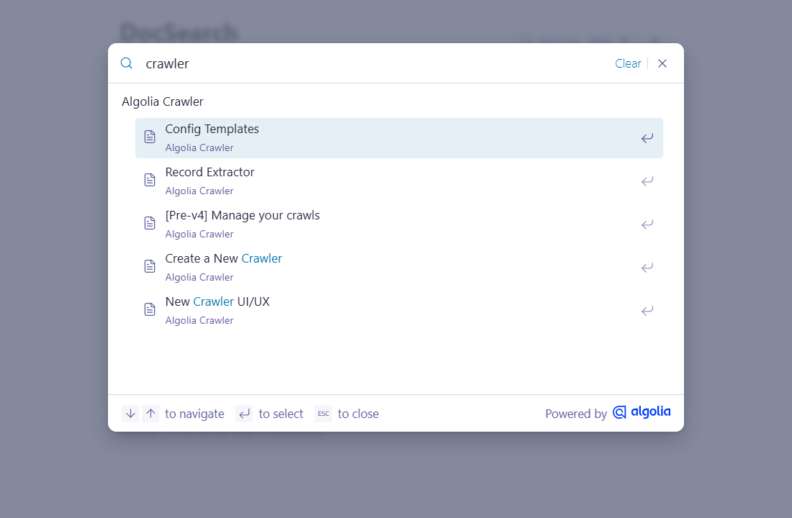

# DocSearch component theme

The _DocSearch_ component theme for [Cecil](https://cecil.app) adds [Algolia DocSearch](https://docsearch.algolia.com) to a website: a search button and a search modal, querying an Algolia index of the website.



**[Demo](https://cecilapp.github.io/theme-docsearch/)**

## Features

- **DocSearch v5 button and modal**: `Ctrl`/`⌘` + `K` and `/` shortcuts, keyboard navigation, recent and favorite searches
- **Ask AI** (optional), with an Algolia Agent Studio agent
- **Multilingual**: results are filtered on the current language
- **Translatable** (English and French included)
- **Light and dark modes**, following the `data-theme` attribute of the root element

## Prerequisites

DocSearch requires an Algolia index of the website: [apply to the DocSearch program](https://docsearch.algolia.com/apply/) (free for open source documentation), or [run your own crawler](https://www.algolia.com/doc/tools/crawler/getting-started/overview/).

See [Crawler configuration](docs/crawler.md) to adapt the crawler to a Cecil website.

## Installation

```bash
composer require cecil/theme-docsearch
```

> Or [download the latest archive](https://github.com/Cecilapp/theme-docsearch/releases/latest/) and uncompress its contents in `themes/docsearch`.

## Usage

Add `docsearch` in the `theme` section of the `config.yml`, with the Algolia credentials:

```yaml
theme:
  - docsearch
docsearch:
  appId: <YOUR_APP_ID>
  apiKey: <YOUR_SEARCH_API_KEY>
  indexName: <YOUR_INDEX_NAME>
```

> [!IMPORTANT]
> Use the **search-only** API key: it is published in the HTML of the pages.

Add the `<head>` tags (language meta, Algolia preconnect and DocSearch stylesheet) in the main template:

```twig
{{ include('partials/docsearch/head.html.twig') }}
```

Add the search box (button and script) where the button should be displayed, for example in the header:

```twig
{{ include('partials/docsearch.html.twig') }}
```

The button container and the script can also be included separately:

```twig
{# in the header #}
{{ include('partials/docsearch/button.html.twig') }}
{# before </body> #}
{{ include('partials/docsearch/script.html.twig') }}
```

> [!TIP]
> The partials render nothing until `appId`, `apiKey` and `indexName` are set, so they can be safely included in a theme.

### Configuration

Options (default values):

```yaml
docsearch:
  enabled: true # display the search box (requires `appId`, `apiKey` and `indexName`)
  appId: '' # Algolia application ID
  apiKey: '' # Algolia search API key
  indexName: '' # Algolia index name
  version: '5' # DocSearch version (5 or later), loaded from jsDelivr
  library: '' # URL of the DocSearch JS library (overrides `version`)
  stylesheet: '' # URL of the DocSearch stylesheet (overrides `version`)
  container: '#docsearch' # CSS selector of the element replaced by the search button
  language: true # filter the results on the current language (`lang` facet)
  insights: false # send search events to Algolia Insights
  placeholder: '' # placeholder of the search input ("Search docs" by default)
  search_parameters: {} # additional Algolia search parameters
  askAi: '' # Ask AI: Agent Studio agent ID, or `askAi` options (disabled by default)
```

> [!NOTE]
> The DocSearch library and stylesheet are downloaded from jsDelivr at build time, and published with the website.
> The theme requires DocSearch **v5**: `version` selects a v5 release (for example `'5.1'`), older versions are not supported.

### Language

Results are filtered on the current language with the `lang` facet (`facetFilters: ['lang:<language>']`), filled by the crawler with the `lang` attribute of the `<html>` element. Set `language: false` if the index has no `lang` facet. See [Crawler configuration](docs/crawler.md#language).

Other [search parameters](https://www.algolia.com/doc/api-reference/search-api-parameters/) can be added (and `facetFilters` overridden) with `search_parameters`:

```yaml
docsearch:
  search_parameters:
    facetFilters: ['lang:en', 'version:2']
    hitsPerPage: 10
```

The search parameters are applied to the index (`indices: [{name: <indexName>, searchParameters: …}]`).

### Ask AI

[Ask AI](https://docsearch.algolia.com/docs/agent-studio/getting-started) answers questions in the search modal, with an Algolia Agent Studio agent. Set the agent ID to enable it:

```yaml
docsearch:
  askAi: <YOUR_AGENT_ID>
```

Other `askAi` options can be set with a mapping, passed as is to DocSearch:

```yaml
docsearch:
  askAi:
    agentId: <YOUR_AGENT_ID>
    suggestedQuestions: true
```

> [!NOTE]
> With Ask AI, the full DocSearch library (`index.min.js`) is loaded instead of the keyword search library (`docsearch.min.js`), about twice as large. Ask AI texts are not translated by the theme.

### Container

The search button replaces the element matching `container`. To use your own element, set its selector and only include the script:

```yaml
docsearch:
  container: '#search'
```

```twig
<div id="search"></div>
{{ include('partials/docsearch/script.html.twig') }}
```

### Styles

DocSearch styles are customized with [CSS custom properties](https://docsearch.algolia.com/docs/styling), for example:

```css
:root {
  --docsearch-highlight-color: #1447e6;
}
:root[data-theme='dark'] {
  --docsearch-highlight-color: #8ec5ff;
}
```

> [!IMPORTANT]
> Declare these properties after `partials/docsearch/head.html.twig`: the DocSearch stylesheet declares them on `:root` and `:root[data-theme='dark']` too.

The dark mode is enabled by a `data-theme="dark"` attribute on the root element, as set by Cecil's theme selector.

On hover and keyboard focus, the search button gets an accent border, customizable with `--docsearch-search-button-hover-border-color`. A shadow can be added too, for example:

```css
.DocSearch-Button:hover,
.DocSearch-Button:focus-visible {
  box-shadow: 0 4px 14px rgb(0 0 0 / 15%);
}
```

The `<head>` partial also resets the styles that classless CSS frameworks, like [Pico CSS](https://picocss.com) used by Cecil's default layout, apply inside the search modal (backdrop, search input, buttons and highlighted terms).

### Internationalization

The theme is translated in English and French. Extract the strings to translate in another language with:

```bash
cecil util:translations:extract --locale=<locale> --save --theme=docsearch
```

## License

_DocSearch_ component theme is a free software distributed under the terms of the MIT license.

[DocSearch](https://github.com/algolia/docsearch) © Algolia, released under the MIT license.
